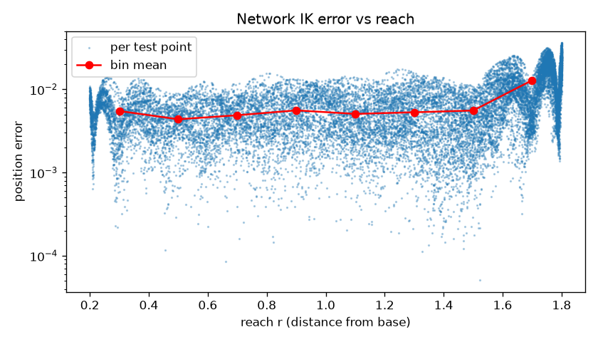
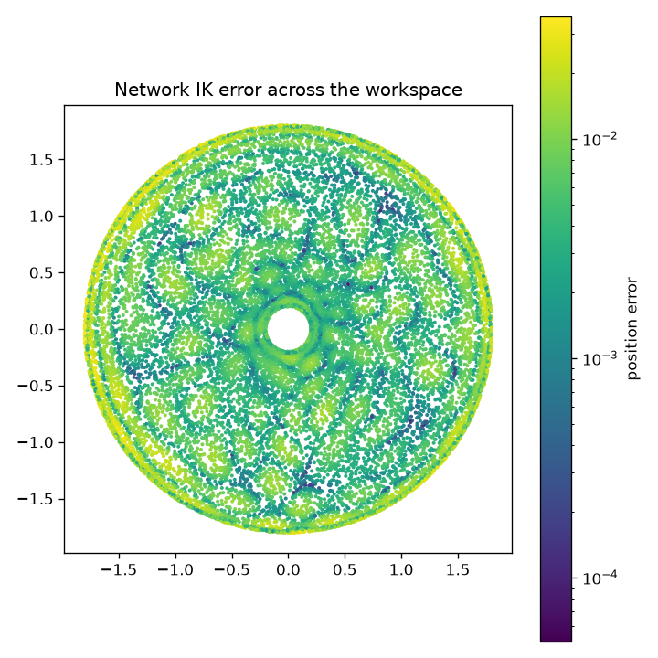
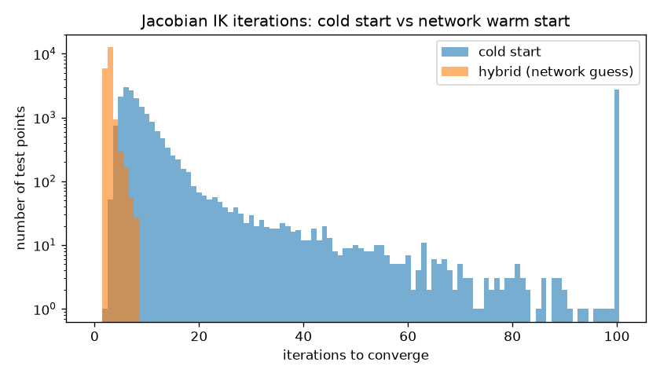
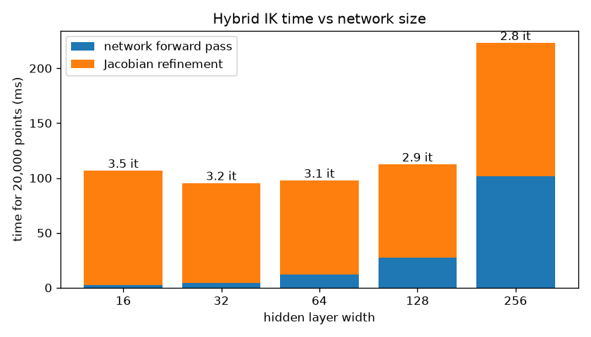

# Learned vs. Analytical Inverse Kinematics

Can a neural network help solve inverse kinematics (IK) for a planar 2-link arm?

This project trains an MLP to approximate IK and benchmarks it against the exact closed-form solver. It then puts the network where it actually helps: as a warm start for an iterative Jacobian solver. Finally, profiling-driven optimization makes the hybrid solver about 10x faster than its first version, with verified identical results.

Builds on my [arm-sim](https://github.com/genius-mathematician/arm-sim) kinematics simulator.

## Key results

All results are on 20,000 held-out test points, run on CPU.

| Question | Result |
|---|---|
| Network alone vs. analytical IK | Network mean position error 7.6e-3 (about 0.4% of reach). Analytical is exact (~1e-16) and about 19x faster. **For 2 links, closed form wins.** |
| Network as warm start for Jacobian IK | Convergence 86.3% -> **100%**. Mean iterations 9.7 -> **2.8**. Wrong-elbow solutions 6,571 -> **0**. |
| Network size sweep | A 32-wide network (2,340 params) works as well in the hybrid as a 256-wide one (133,380 params), with **57x fewer parameters**. |
| Profiling-driven solver optimization | Refinement 78.8 ms -> **14.0 ms (5.6x)**. Iteration counts 100% identical, max angle difference 5.4e-14 rad. |
| End to end (20k points) | Cold-start Jacobian 684 ms. First hybrid 181 ms. **Optimized hybrid ~18.5 ms**. Analytical ~4 ms. |

## Setup

**Arm.** Link lengths L1 = 1.0, L2 = 0.8. The workspace is a ring from r = 0.2 to r = 1.8.

**Data** (`data.py`). Random joint angles are pushed through forward kinematics to give exact (x, y) -> (theta1, theta2) pairs. The splits are 200k train, 20k validation and 20k test, with a fixed seed.

theta2 is restricted to (0, pi), which is a single elbow configuration. Every reachable point has two IK solutions, and a network trained on both would learn their average, which is not a valid pose.

**Model** (`train.py`). An MLP with 2 inputs, three hidden layers (SiLU), and 4 outputs. It predicts (cos theta, sin theta) for each joint, and the angles are recovered with `atan2`. This avoids the jump at +/-pi that makes raw angle regression fail. Inputs are normalised by full reach.

Training uses Adam with a learning rate of 1e-3 on a cosine schedule, 40 epochs, and batch size 1024. The checkpoint with the best validation loss is kept.

## Findings

### 1. On its own, the network loses (`evaluate.py`)

| Position error | mean | median | p95 | p99 | max |
|---|---|---|---|---|---|
| Network (width 256) | 7.57e-3 | 5.86e-3 | 2.07e-2 | 2.75e-2 | 3.61e-2 |
| Analytical | 1.68e-16 | 1.24e-16 | 4.58e-16 | 6.28e-16 | 9.42e-16 |

The error is flat (mean about 5e-3) from r = 0.3 to 1.6. In the outer band (1.6-1.8), where the arm is nearly fully stretched, the mean more than doubles to 1.3e-2. There are two causes:

- **Infinite slope.** Near the boundary, theta2 grows like the square root of the distance from the edge, and a smooth network cannot follow a vertical tangent.
- **Leverage.** A base-angle error moves the hand by r times that error, so the same mistake costs 9x more at r = 1.8 than at r = 0.2.

The outer band also had the *densest* training data, so the problem is the shape of the function, not a shortage of data. The error map also shows a cellular ripple pattern, which is typical of an MLP that has not fully converged.

### 2. As a warm start, the network helps (`hybrid.py`)

The refinement is damped least-squares Jacobian IK (Levenberg-Marquardt style), with tolerance 1e-10 and at most 100 iterations. Two starting points are compared:

- a cold start from a fixed neutral pose, theta = (0, 90 degrees)
- a warm start from the network's guess

| Method | Converged | Mean iters | p99 | Max | Wrong elbow | Time |
|---|---|---|---|---|---|---|
| Cold start | 86.33% | 9.71 | 51 | 100 | 6,571 | 684 ms |
| Hybrid (network, width 256) | **100%** | **2.82** | 6 | 8 | **0** | 181 ms |

The network is only roughly accurate, and the solver needs a good starting point. Combining them covers both weaknesses: the network gets the solver close, and the solver delivers 1e-10 precision.

The cold start lands on the *wrong elbow* for a third of the points. A real robot would swing its elbow to the opposite side to reach those targets. The warm start never does.

### 3. A much smaller network is enough (`sweep.py`)

| Width | Params | Net error | Mean iters | Wrong elbow | Net ms | Refine ms | Total ms |
|---|---|---|---|---|---|---|---|
| 16 | 660 | 5.44e-2 | 3.55 | **15** | 2.24 | 104.55 | 106.79 |
| **32** | **2,340** | 1.92e-2 | 3.17 | 0 | 4.47 | 91.03 | **95.50** |
| 64 | 8,772 | 1.66e-2 | 3.08 | 0 | 12.35 | 85.47 | 97.82 |
| 128 | 33,924 | 8.07e-3 | 2.88 | 0 | 27.26 | 85.29 | 112.55 |
| 256 | 133,380 | 7.57e-3 | 2.82 | 0 | 101.72 | 121.44 | 223.16 |

Width 16 is rejected on correctness: its rougher guesses sometimes push the solver onto the wrong elbow. Widths 32 and 64 are tied within timing noise, and 32 is chosen because it is smaller.

With the small network, refinement takes 95% of the total time, so that is where to optimize next.

### 4. Profile, then optimize (`profile_refine.py`, `refine_fast.py`)

Line-level profiling (line_profiler) of the refinement loop showed where the time went:

| Line | Share of time | What it does |
|---|---|---|
| `np.linalg.solve` | 28.4% | Calls a general-purpose solver for a 2x2 system |
| Forward kinematics | 23.2% | Recomputed for all 20k points every pass, even after most had converged |
| `J @ J.T` | 22.3% | Batched matrix multiply on tiny 2x2 matrices |
| Jacobian | 10.7% | Recomputes trig values already computed for forward kinematics |

Three fixes addressed this:

1. Converged points are removed from the working arrays.
2. sin and cos are computed once per pass and shared between forward kinematics and the Jacobian.
3. The symmetric 2x2 damped solve is written out in closed form.

**Verification.** The iteration counts are 100% identical on all 20,000 points. The maximum angle difference is 5.4e-14 rad. Convergence, wrong-elbow count and error are unchanged.

**Speedup.** Refinement time dropped from 78.8 ms to 14.0 ms (5.6x). End to end, the hybrid went from 181 ms to about 18.5 ms (4.5 ms network + 14.0 ms refinement, measured separately).

## Limitations

- **For a 2-link arm, use the closed form.** It is exact and still about 4x faster than the optimized hybrid. The hybrid result is relevant to arms *without* closed-form IK (redundant or N-link arms, or arms with joint limits), which this project does not yet test.
- **Timing setup.** All timings come from one Windows machine with 4 CPU threads and are the median of repeated runs. Run-to-run variation of up to about 30% was observed, so small gaps such as width 32 vs. 64 are within noise.
- **Cold-start pose.** The cold start uses a fixed neutral pose. In a tracking loop, starting from the arm's current pose would converge faster.
- **One seed.** Everything was run with a single seed.

## Next steps

- Extend to a 3-link redundant arm, where no closed form exists.
- Compare learned warm starts against previous-pose warm starts along trajectories.

## Reproduce

Requires [uv](https://docs.astral.sh/uv/).

    uv sync
    uv run python data.py            # dataset (regenerated exactly from the seed)
    uv run python train.py           # width-256 model (--hidden N to change)
    uv run python evaluate.py        # network vs analytical
    uv run python hybrid.py          # cold start vs warm start
    uv run python sweep.py           # network size sweep
    uv run python profile_refine.py  # line-level profile of refinement
    uv run python refine_fast.py     # optimized solver: verification + benchmark

Trained models are included in `models/`, so the evaluation scripts run without retraining.

## Files

| File | Purpose |
|---|---|
| `data.py` | Dataset generation via forward kinematics |
| `train.py` | IKNet model and training loop (CLI) |
| `evaluate.py` | Accuracy, error by reach, and speed vs analytical IK |
| `hybrid.py` | Damped least-squares refinement, cold vs warm start |
| `sweep.py` | Network size vs iterations vs time |
| `profile_refine.py` | Line-level profiling |
| `refine_fast.py` | Optimized refinement with correctness checks |
